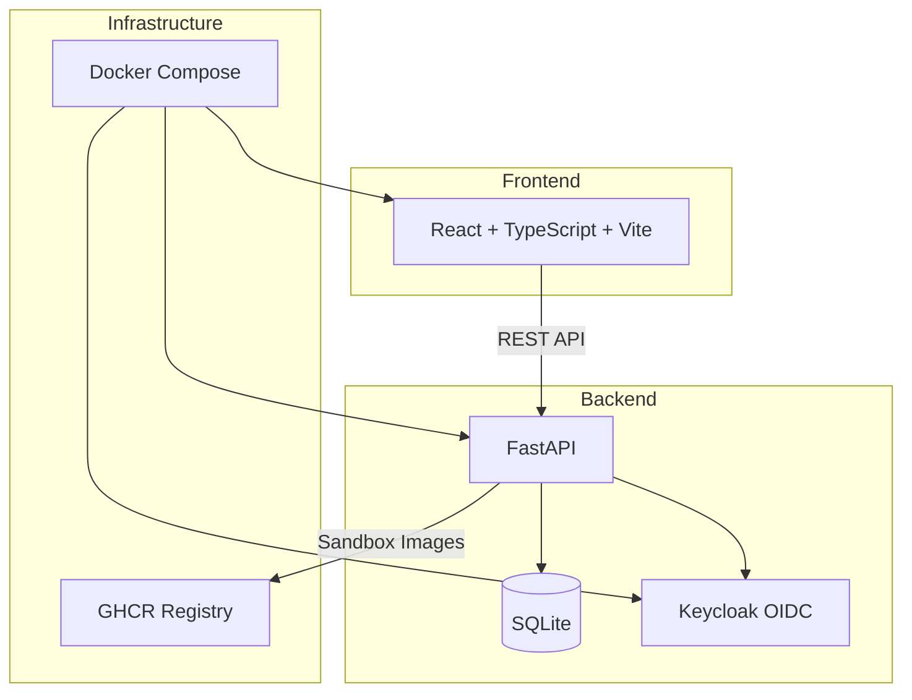

# Lumen Lab — Ryan Vo

> Work in progress. This checkpoint may be incomplete or fail tests. See PLAN.md and STATUS.md before use.


**Scale computer-use 2.0 with open-source drivers, cross-OS sandboxes, and benchmarks for training, evaluation, and data generation.**

Ryan Vo | AI & Machine Learning

## Overview

Lumen Lab is a developer toolkit for scaling computer-use automation across operating systems. It provides:

- **Driver Benchmarks**: Configurable latency measurements for computer-use drivers (addressing [cua#3971](https://github.com/trycua/cua/issues/3971))
- **Cross-OS Sandboxes**: ARM64-compatible VM management with GHCR publishing (addressing [cua#353](https://github.com/trycua/cua/issues/353), [cua#22](https://github.com/trycua/cua/issues/22))
- **Hyprland Isolated Input**: Synthetic seat configuration for background input isolation (addressing [cua#3550](https://github.com/trycua/cua/issues/3550))
- **Cooperative Cancellation**: In-flight operation cancellation with partial results (addressing [cua#3796](https://github.com/trycua/cua/issues/3796))

## Architecture



## Quick Start

### Prerequisites

- Docker and Docker Compose
- Node.js 24+ (for local frontend development)
- Python 3.12+ (for local backend development)

### Using Docker Compose (Recommended)

```bash
# Clone and navigate
cd lumen-lab-ryan-vo

# Copy environment template
cp .env.example .env

# Start all services
docker compose up -d

# Access services
# Frontend: http://localhost
# Backend API: http://localhost:8000
# Keycloak: http://localhost:8080 (admin/admin)
```

### Local Development

#### Backend

```bash
cd backend
python -m venv .venv
source .venv/bin/activate
pip install -r requirements.txt
cp ../.env.example .env
# Edit .env as needed
python -m uvicorn app.main:app --reload --host 127.0.0.1 --port 8000
```

#### Frontend

```bash
cd frontend
npm install
npm run dev
# Access at http://localhost:5173
```

## Testing

### Backend Tests

```bash
cd backend
source .venv/bin/activate
python -m pytest tests/ -v
```

### Frontend Tests

```bash
cd frontend
npm test
```

### Full Test Suite

```bash
# From project root
docker compose -f compose.yaml build
docker compose -f compose.yaml run --rm backend python -m pytest backend/tests/ -v
docker compose -f compose.yaml run --rm frontend npm test
```

## API Reference

### Health

- `GET /api/v1/health` - Health check with database status
- `GET /api/v1/health/ready` - Readiness probe

### Benchmarks (Planned)

- `GET /api/v1/benchmarks` - List benchmarks with pagination
- `POST /api/v1/benchmarks` - Create new benchmark run
- `GET /api/v1/benchmarks/{id}` - Get benchmark details
- `GET /api/v1/benchmarks/{id}/results` - Get benchmark results

### Sandboxes (Planned)

- `GET /api/v1/sandboxes` - List sandbox environments
- `POST /api/v1/sandboxes` - Create new sandbox
- `GET /api/v1/sandboxes/{id}` - Get sandbox details
- `DELETE /api/v1/sandboxes/{id}` - Delete sandbox

### Hyprland (Planned)

- `GET /api/v1/hyprland/config` - Get Hyprland configuration
- `POST /api/v1/hyprland/authorize` - Authorize operator session

### Authentication

- `GET /api/v1/auth/login` - Initiate OIDC login
- `GET /api/v1/auth/callback` - OIDC callback
- `POST /api/v1/auth/logout` - Logout

## Configuration

### Environment Variables

See `.env.example` for all configurable options.

### Keycloak Roles

- **viewer**: Read-only access to dashboards
- **operator**: Can run benchmarks, manage sandboxes, configure Hyprland
- **admin**: Full administrative access (includes viewer + operator)

Default users (development only):
- `admin` / `admin` (admin role)
- `operator` / `operator` (operator role)
- `viewer` / `viewer` (viewer role)

## AI/ML Evaluation

This project addresses real-world computer-use automation challenges documented in the [Cua project issues](https://github.com/trycua/cua/issues):

| Issue | Problem | Lumen Lab Solution |
|-------|---------|-------------------|
| [#353](https://github.com/trycua/cua/issues/353) | No ARM64 Docker images for Apple Silicon | ARM64-compatible sandbox images with GHCR publishing |
| [#3971](https://github.com/trycua/cua/issues/3971) | Unconfigurable post-action observation delays | Configurable observation/settle timeouts per session/action |
| [#3550](https://github.com/trycua/cua/issues/3550) | No isolated background input on Hyprland | Synthetic seat configuration with operator authorization |
| [#3796](https://github.com/trycua/cua/issues/3796) | Cancellation leaves held input, no partial results | Cooperative cancellation with partial evidence return |

### Reproducible Benchmark Command

```bash
# Run latency benchmark with custom timeouts
curl -X POST http://localhost:8000/api/v1/benchmarks \
  -H "Content-Type: application/json" \
  -d '{
    "name": "latency-test",
    "observation_timeout_ms": 500,
    "settle_timeout_ms": 200,
    "poll_interval_ms": 16
  }'
```

### Baseline Measurements (from cua#3971)

| Action | First State Change | MCP Call Returned |
|--------|-------------------|-------------------|
| Click block text field | 84.89 ms | 1900.10 ms |
| Press Enter | 35.26 ms | 1103.07 ms |
| Press Tab | 24.62 ms | 1108.34 ms |

These measurements demonstrate the latency gap that configurable timeouts aim to address.

### Failure Cases

- ARM64 images unavailable on upstream registries
- Hyprland synthetic seat requires specific compositor version
- Cooperative cancellation depends on driver support
- Keycloak SAML brokering requires IdP configuration

## Security

- All API endpoints require authentication (except health checks)
- HttpOnly SameSite cookies for session management
- CSRF protection on state-changing operations
- Role-based authorization on all data endpoints
- No hardcoded credentials; all secrets via environment variables
- Demo mode binds to localhost only; refuses startup in production

## Deployment

### TLS Reverse Proxy

Use a reverse proxy (nginx, Traefik, Caddy) for TLS termination:

```nginx
server {
    listen 443 ssl http2;
    server_name lumen-lab.example.com;

    ssl_certificate /path/to/cert.pem;
    ssl_certificate_key /path/to/key.pem;

    location / {
        proxy_pass http://frontend:80;
    }

    location /api {
        proxy_pass http://backend:8000;
    }
}
```

### Backup/Restore

```bash
# Backup database
docker compose exec backend cp /app/data/lumen_lab.db /app/data/lumen_lab.db.backup

# Backup Keycloak
docker compose exec keycloak /opt/keycloak/bin/kc.sh export --dir /opt/keycloak/data/backup --realm lumen-lab
```

## License

MIT License - Copyright (c) 2024 Ryan Vo <ryandtvo@gmail.com>

## Author

Ryan Vo <ryandtvo@gmail.com>
GitHub: [A220man](https://github.com/A220man)